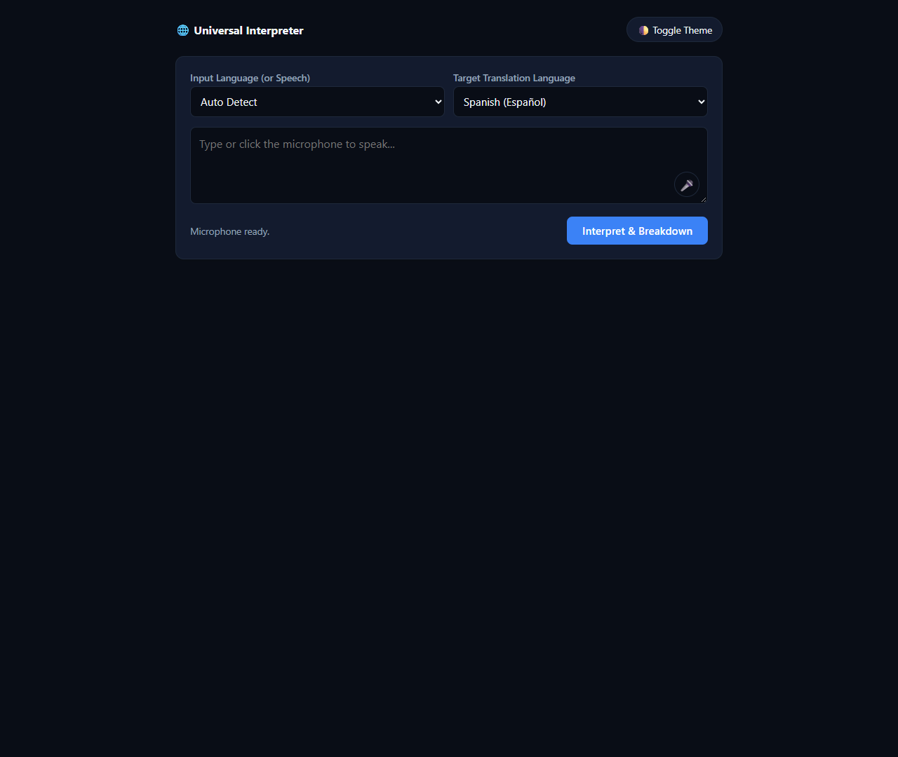
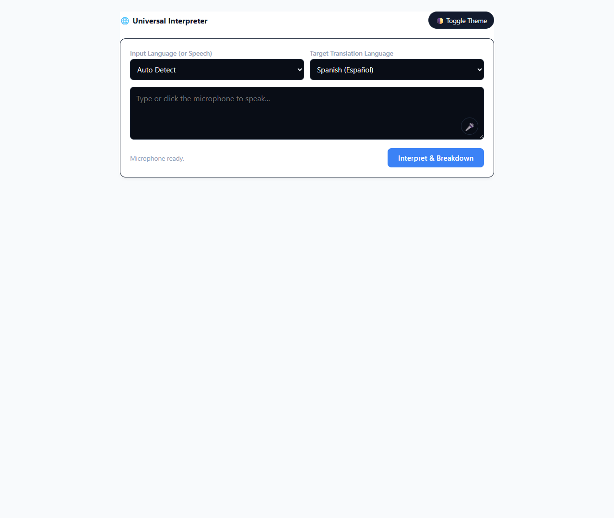
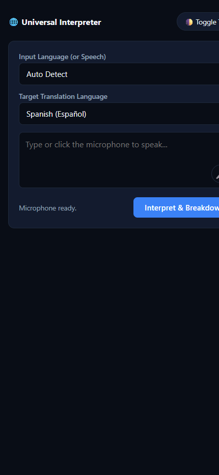
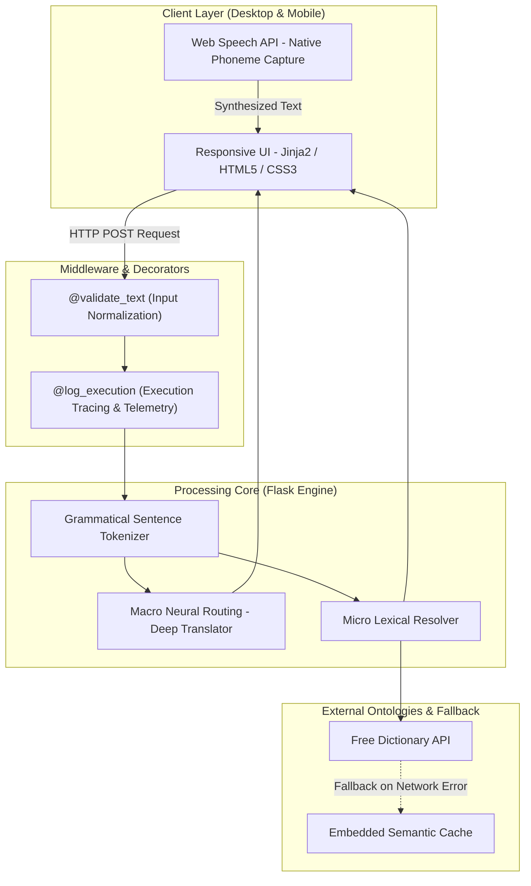

<div align="center">

# 🌐 LexiBridge AI — Interactive Interpreter & Contextual Lexicon

[](https://www.python.org/)
[](https://flask.palletsprojects.com/)
[](https://opensource.org/licenses/MIT)
[](#mobile-access)

<p align="center">
  <strong>Bridging holistic speech interpretation and granular lexical understanding into an integrated pedagogical experience.</strong>
</p>

[Key Features](#-key-features) • [Screenshots](#-interface-preview) • [Architecture](#-computational-architecture) • [Getting Started](#-installation--setup) • [Academic Context](#-academic-documentation)

---

</div>

## 📌 Executive Summary

Conventional real-time translation platforms treat spoken or written discourse as a single monolithic block. While useful for swift communication, they hide syntactic structures, word definitions, and contextual examples essential for language acquisition.

**LexiBridge AI** bridges this gap using a **Dual-Analysis Computational Architecture**:
1. **Macro-Level Interpretation**: Whole-sentence natural translation maintaining semantic coherence.
2. **Micro-Level Lexical Decomposition**: Dynamic tokenization of sentences into isolated lexemes, querying lexical ontology endpoints (Free Dictionary API + cached offline semantics) to expose grammatical category (part of speech), definitions, contextual usage, and phonetics via interactive cards.

---

## 📸 Interface Preview

<div align="center">

### 🌙 Dark Theme (Active Lexical Breakdown)


<br/>

| ☀️ Light Theme Interface | 📱 Responsive Mobile Experience |
|:---:|:---:|
|  |  |

</div>

---

## ✨ Key Features

- 🔄 **Two-Way Real-Time Interpretation**: Smooth bidirectional translation with support for over 100+ language pairs via deep translation pipelines.
- 📖 **Interactive Lexeme Dropdowns (`<details>`)**: Every tokenized word renders as an individual collapsible card with:
  - Translated target equivalent
  - Grammatical part of speech (*noun, verb, adjective, interjection, etc.*)
  - Formal definition
  - Authentic contextual sentence examples
- 🎙️ **Zero-Dependency Web Voice Input**: Built directly on top of the W3C Web Speech API standard — delegates acoustic phoneme modeling to client hardware without bulky binary C-dependencies (eliminating PyAudio / C++ runtime errors).
- 🛡️ **Aspect-Oriented Function Decorators**:
  - `@validate_text`: Intercepts raw inputs, normalizes boundary whitespace, and validates string non-emptiness before processing.
  - `@log_execution`: Audits functional lifecycle states, diagnostic metrics, and processing timestamps without polluting business logic.
- 🌓 **Dynamic Theme Toggling**: Instant client-side switching between dark and light themes with persistence.
- 📱 **Cross-Platform Responsive Design**: Accessible concurrently across local networks on desktop computers, iOS Safari, and Android Chrome.

---

## 🏛️ Computational Architecture



---

## 🚀 Installation & Setup

### Prerequisites
- Python 3.10 or higher
- `git` installed on your system
- An active internet connection (for dictionary and translation endpoints)

### 1. Clone the Repository
```bash
git clone https://github.com/cmdRxyz/ai-interpreter-dictionary.git
cd ai-interpreter-dictionary
```

### 2. Set Up a Virtual Environment (Recommended)
```bash
# Windows (PowerShell)
python -m venv venv
.\venv\Scripts\Activate.ps1

# macOS / Linux
python3 -m venv venv
source venv/bin/activate
```

### 3. Install Dependencies
```bash
pip install -r requirements.txt
```

### 4. Run the Application
```bash
python app.py
```

### 5. Access the Web Interface
- **On your Local PC**: Open [http://localhost:5000](http://localhost:5000)
- **On Mobile Devices (Android / iOS)**:
  Ensure your mobile device is on the same Wi-Fi network as your host computer. Open your mobile browser and navigate to:
  ```text
  http://<YOUR_LOCAL_IP>:5000
  ```
  *(To find your local IP on Windows run `ipconfig`; on macOS/Linux run `ifconfig` or `ip a`).*

---

## 📂 Project Structure

```text
ai-interpreter-dictionary/
├── app.py                                  # Core Flask application, decorators & logic
├── requirements.txt                        # Production package dependencies
├── Documentation_Interpreter_Dictionary.docx # Full Academic research paper
├── .gitignore                              # Environment & temporary cache ignore rules
├── docs/
│   └── screenshots/                        # Application preview assets
│       ├── 01_interpreter_dark_mode.png
│       ├── 02_interpreter_light_mode.png
│       └── 03_mobile_responsive_view.png
└── README.md                               # Project documentation & presentation
```

---

## 🔬 Academic Documentation

This project was developed as an academic exploration into computational linguistics and contextual second-language acquisition pedagogy.

The comprehensive paper (`Documentation_Interpreter_Dictionary.docx`) covers:
1. **Executive Abstract and Pedagogical Gaps in Monolithic Interpreters**
2. **Discourse-Level vs. Lexeme-Level Dual Analysis Theoretical Paradigm**
3. **Behavioral Abstraction via Aspect-Oriented Python Decorators**
4. **Hardware-Accelerated Client Phoneme Processing vs. Native Server Audio Compilations**
5. **Evaluation, Error Handling, and Offline-First Local Cache Stratification**

---

## 🛠️ Roadmap & Future Enhancements

- [ ] **Standalone Desktop Executable (`.exe`)**: Packaging via PyInstaller for single-click local launching.
- [ ] **Progressive Web App (PWA)**: Offline service workers and mobile home-screen installability.
- [ ] **Custom Offline Ontology**: Local SQLite vector embeddings for dictionary queries in fully air-gapped environments.

---

## 📄 License

Distributed under the MIT License. See `LICENSE` for more information.
